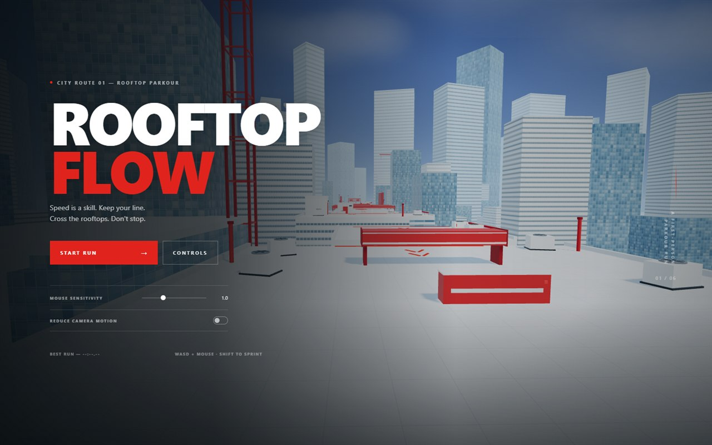
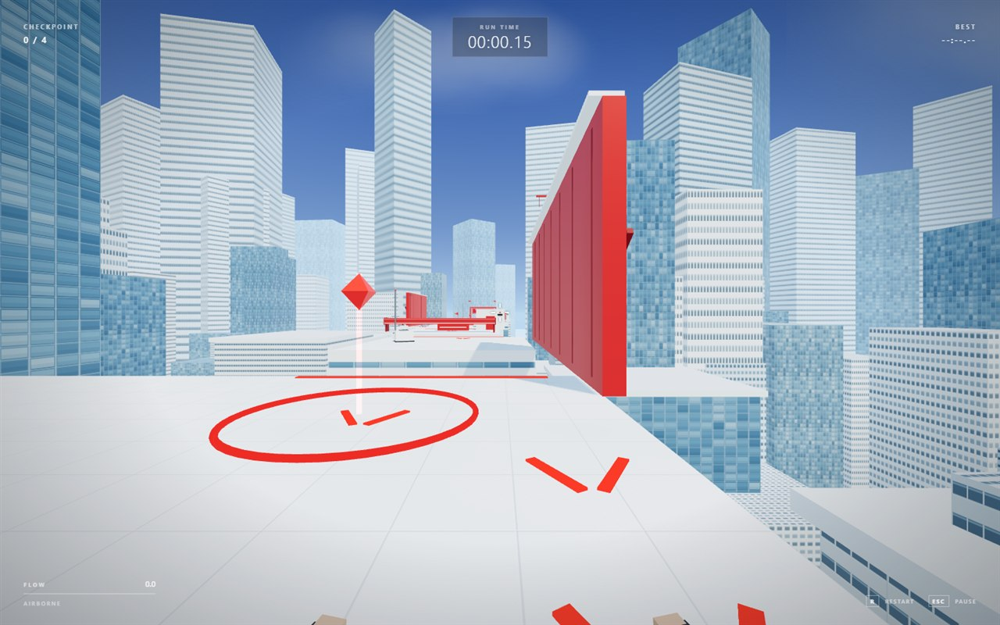
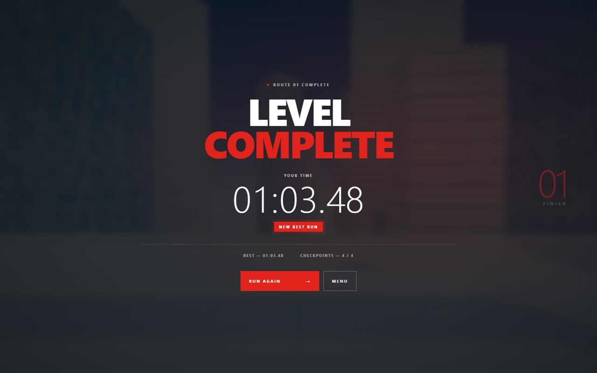

# ROOFTOP FLOW

A complete first-person rooftop parkour game for the browser, built with **Three.js**, **TypeScript** and **Vite**. Sprint, jump, slide, vault and wall-run across a bright white city route, hit the checkpoints and reach the red finish gate.

Everything you see and hear is generated at runtime: geometry, textures, the skyline and the sound effects. There are no external assets, no backend and no third-party game engine.

## Screens







## Run it

```bash
npm install
npm run dev
```

Open the local URL printed by Vite (by default `http://127.0.0.1:5173`). A desktop browser with WebGL 2 and pointer lock is recommended.

Production build:

```bash
npm run build
npm run preview
```

## Controls

| Input | Action |
| --- | --- |
| `W A S D` | Move |
| Mouse | Look |
| `Shift` | Sprint |
| `Space` | Jump / wall jump / mantle |
| `Ctrl` or `C` | Slide |
| `E` | Vault / interact |
| `R` | Restart from the last checkpoint |
| `Esc` | Pause |

Hold `Space` for a taller jump, release early for a shorter one. Movement settings (sensitivity and reduced camera motion) are available in the title screen and the pause menu and are saved locally.

## The route

The level is one continuous course along the rooftops, split into six readable sections:

1. **Warm up** — a large starting roof with a red vault barrier, a low vent to slide under, and the first gap.
2. **Rooftop jumps** — five rooftops at different heights, separated by gaps that reward a committed sprint.
3. **Vent run** — a long roof crossed by three full-width red vents. Sliding is mandatory.
4. **Wall run** — a 14 m gap that cannot be jumped. Leap into the long red wall and run along it to the next roof.
5. **The line** — slide under a vent, vault a barrier, jump a gap and chain a second wall run on the opposite side.
6. **Final sprint** — a fast chain of rooftops ending at the red finish gate.

There are four checkpoints (red floor rings with a floating marker). Crossing the finish line shows your time, your best time (stored in `localStorage`) and a new-best badge when you beat it.

## Features

- Momentum-based movement with acceleration, air control, coyote time, jump buffering and variable jump height.
- Slide with a lower collision height, preserved momentum and automatic standing when there is headroom.
- Wall running with wall detection, reduced gravity, camera tilt, wall jumps and a duration limit.
- Vaulting over low obstacles with a smooth procedural arc and preserved momentum.
- Automatic ledge mantling for near-misses at roof edges.
- Collision-safe fixed-timestep physics (120 Hz) with substepping, so high speeds cannot tunnel through geometry.
- Speed-driven FOV, head bob, strafe roll, landing springs and a reduced-motion option.
- Procedural textures, a bright gradient sky, sun shadows, distance haze, an instanced background city and styled low-poly props.
- Full UI flow: title screen, controls sheet, HUD, pause menu, finish screen, best-time persistence.
- Synthesised Web Audio effects: footsteps, jump, landing, sliding loop, wind, checkpoint chime and finish fanfare.

## Project structure

```
src/
  main.ts                  entry point
  game/
    Game.ts                renderer, game loop, flow and triggers
    GameState.ts           phase, timer, best time
  input/
    Input.ts               keyboard + pointer-lock input
  player/
    PlayerController.ts    movement state, input interpretation, events
    PlayerPhysics.ts       AABB collision solver / character controller
    ParkourSystem.ts       wall run, vault, ledge mantle
    FirstPersonCamera.ts   look, bob, FOV, roll, landing camera
    PlayerBody.ts          first-person forearms / hands
  world/
    Level.ts               the hand-built rooftop course
    CollisionWorld.ts      AABB collider store and wall probes
    CityGenerator.ts       instanced procedural skyline
    Checkpoints.ts         checkpoint markers and activation gates
    Environment.ts         sky, sunlight, fog, env map, clouds
    Materials.ts           shared materials and tiled surfaces
    Textures.ts            procedural canvas textures
  ui/
    HUD.ts                 timer, hints, checkpoint feedback, speed meter
    Menu.ts                title, controls, pause and finish screens
  audio/
    AudioManager.ts        Web Audio synthesis
  styles/
    main.css               UI styling
```

## Tuning notes

- The movement constants live at the top of `PlayerController.ts`. Sprint speed is 11.3 m/s and the jump velocity is 9.25 m/s at 25 m/s² gravity, giving roughly 8 m of flat jump distance at full sprint.
- Level geometry is defined as axis-aligned boxes in `Level.ts`; the same boxes are used for the render meshes and the collision world. Take-off edges on the route are marked with thin red strips.
- The player is a 0.36 m radius box, 1.8 m tall standing and 0.95 m tall sliding. Physics runs at a fixed 120 Hz independent of rendering.
- Shadows use a 2048² PCF map that follows the player. The renderer caps pixel ratio at 2 for performance.

The game is an original work inspired by the parkour genre. It does not use assets, level layouts or code from Mirror's Edge.
